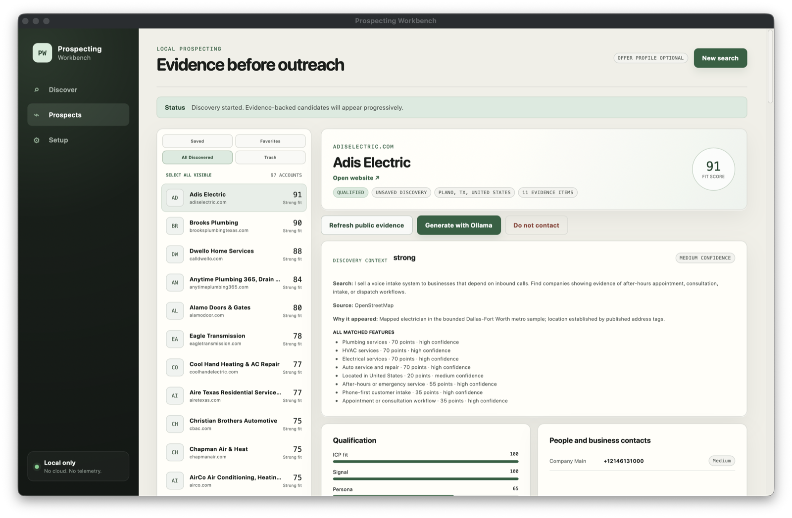
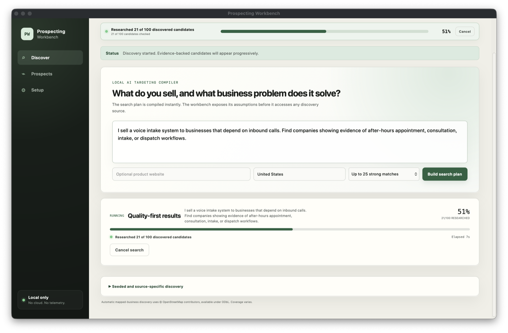

# Prospecting Workbench

A local-first desktop application for B2B prospect research. You describe what you sell in plain language; it finds U.S. companies that match, collects public evidence about each one, and will not state anything it cannot attribute to a source.

The app compiles a search plan you can read and edit before anything runs, including the signals a good customer's own website would show. It then discovers candidates from free public sources, reads their public web pages, scores fit using those rules in application code, and drafts outreach with a local 9B model. Every factual sentence in a draft must quote a stored evidence row, or it is removed before you see it.

Everything runs on your machine. There is no account, server, telemetry, paid data vendor, or hosted inference.



## Design constraints

The obvious way to build this is to wrap a paid contact database and a chat model. That approach invents contact details, manufactures reasons to reach out, and cannot show where any of it came from.

The rule I worked to instead was that the application may only assert what it can cite, and must say so plainly when it finds nothing. Most of the design follows from that.

Scoring lives in Rust rather than in the model. A model asked to produce a number can be argued into producing any number, so the weights are fixed at 35/30/20/15 and can be audited. The local model may suggest *rules* while you plan, before any company has been seen; it never sees a candidate's pages during qualification, and never sets a score.

The model writes, but it does not assert. A second pass checks each drafted claim against evidence IDs, removes sentences it cannot support, and refuses a draft entirely if nothing cited survives.

Fetched web pages are treated as untrusted input rather than context. HTML is stripped of active and hidden elements, scanned for embedded instruction patterns, and quoted to the model as data.

Missing contact information is shown as missing. Nothing is guessed from a domain pattern.

Sources have to be free and rule-abiding. OpenStreetMap and Wikidata both publish usage policies, and the client honours them through bounded sampling, backoff, caching and mirror failover. Search result pages are never scraped.

## How it works

**Compiling a plan.** A deterministic compiler turns your description into target segments, qualification signals, geography and named discovery lanes. It runs offline and returns immediately, and it lists the assumptions it made so you can correct them. Nothing touches the network until you approve the plan.

Signals come from the product you describe, not from a fixed list. Curated packs cover payroll and scheduling, point of sale and ordering, marketing, ecommerce, IT and security, compliance, finance, recruiting, benefits, logistics, representation, and phone intake. Each pack lists what a *customer's* site would show if they needed that product: "now hiring servers" and "weekly pay" for payroll, "patient portal" and "insurance plans" for HIPAA compliance. If Ollama is running, the local model then suggests a few more. Every signal's keywords can be edited, a signal can be marked required, and signals can be added or removed before the search starts. When you describe what you sell ("payroll software *to restaurants*"), only the audience clause chooses the business type, so the product's own words do not target your competitors.

**Discovery.** Two automatic lanes cover different shapes of company. OpenStreetMap handles businesses with a mapped physical premise, using a curated catalog of 94 verticals across all 50 states and roughly 50 metro areas. Wikidata handles organizations that have no storefront, such as agencies, studios and professional firms. A third optional lane uses a SearXNG instance you run yourself.



**Research and qualification.** Each candidate's public pages are crawled within the limits of its robots.txt. For every approved signal, the first line on the whole page that supports it is quoted as an evidence row, and about-and-team pages yield quoted evidence for target roles. Scripts, stylesheets and booking or ordering links in the page markup reveal about thirty technologies (Shopify, Calendly, Toast, ServiceTitan, HubSpot and others), which signals can cite and exclusions can use as competitor gates.

One matcher decides both what the crawler quotes and what scoring credits. It compares whole words with light stemming, lets a phrase span a few words ("hiring experienced servers" supports "hiring servers"), and rejects negated lines ("we are not hiring"). Each sentence can support one signal at most, so a candidate qualifies on genuinely independent evidence: by default, two signals plus a way to contact the business. Only candidates within four points of the best eligible score are promoted to Strong Match. The rest stay visible as near matches, with the signals they did match shown on each card.

After a run, signals that matched almost every candidate, or none, are flagged. "Edit signals and re-score" applies edited signals to the same candidates using pages read in the last 24 hours, so tuning a plan takes seconds and makes no new requests.

**Drafting.** A pinned local `qwen3.5:9b` composes an email and call brief using Ollama's structured output. A separate pass re-checks every claim against the evidence. The compliance footer is built from the sender identity you approved. The application never sends anything.

## Implementation notes

*Untrusted input.* [`safety.rs`](src-tauri/src/safety.rs) enforces scheme, port, credential and private-address policy, and revalidates on every redirect hop. Content type and response size are capped. Injection markers are stripped from page text before it reaches the model.

*Source query safety.* Generated text never becomes a source query. Overpass filters are `&'static str` literals in [`catalog.rs`](src-tauri/src/catalog.rs). The SPARQL in [`wikidata.rs`](src-tauri/src/wikidata.rs) is a fixed template whose only variable is an entity id validated against `^Q[1-9][0-9]*$`. The local model contributes plain English type names, which are resolved through Wikidata's own search API before anything reaches a query.

*Evidence provenance.* A mapped business with no address tags records its location as the bounded region the query proved it was in, labelled as established by the search area rather than by a published address. Facts that were proven stay distinguishable from facts that were inferred.

*Failure reporting.* A search stopped by its time budget reports how many candidates went unresearched instead of attributing the shortfall to its own scoring band. Rate-limited sources fall back to cache, with the cache age shown.

*Testing.* Parser fixtures cover malformed, duplicate and injection-bearing payloads for every public source. Several tests encode measured behaviour of the live services, so a regression fails by name rather than vaguely.

*Relevance evaluation.* [`eval_fixtures.rs`](src-tauri/src/eval_fixtures.rs) runs four requests (payroll for restaurants, HIPAA compliance for dentists, a screenwriter seeking an agent, and voice intake for plumbers) against a hand-labelled set of realistic company pages through the real planner, extraction and scoring. A floor test holds precision at 1.00 and recall at 0.66 or better. Each corpus includes near-misses that fooled earlier versions, such as "avocado toast", "we are not hiring" and "homeowners". These pages were written alongside the rules, so they measure the mechanism rather than real-world yield. `scripts/live-search-eval.sh` runs the full pipeline against the live sources and reports yield, rule hit rates and quoted reasons for the top matches.

## Architecture

```
React + TypeScript (Vite)          strict TS, no state library
        |  Tauri IPC: typed commands, scoped capabilities
        v
Rust core
  |-- catalog.rs / regions.rs   curated verticals, U.S. bounding boxes
  |-- adapters.rs               OpenStreetMap, SEC, USAspending, SearXNG
  |-- wikidata.rs               open-ended organization discovery
  |-- safety.rs                 fetch policy, SSRF defence, sanitisation
  |-- research.rs               deadline-bounded crawl, page cache, evidence
  |-- signals.rs                product signal packs, rule sanitizing
  |-- matcher.rs                shared stemmed, negation-aware matcher
  |-- technology.rs             website technology fingerprints
  |-- qualification.rs          fixed-weight scoring, hard gates
  |-- ai.rs                     Ollama structured output, verification
  |-- db.rs                     SQLite, migrations, serialized writes
        |
        v
SQLite (app data dir)      Ollama @ 127.0.0.1:11434
```

Roughly 14.5k lines of Rust and 1.9k of TypeScript, with 149 tests. CI runs both test suites, a production build, `cargo fmt --check` and `clippy -D warnings`, and generates an SPDX SBOM.

## Requirements and setup

macOS 13 or later, Node 22+, Rust 1.80+, and [Ollama](https://ollama.com/).

```sh
ollama pull qwen3.5:9b
corepack enable
pnpm install
pnpm tauri dev
```

`pnpm tauri build` produces a standalone `.app`. Discovery and research require internet access; stored records and local drafting work offline.

Keep the repository outside `~/Documents`, `~/Desktop` and `~/Downloads`. macOS tags executables in those directories with a `com.apple.provenance` attribute that blocks the hardlinks cargo uses for build scripts, and Node will fail at startup with `EPERM: uv_cwd` unless the terminal has been granted access to the folder.

## Scope and limitations

The application does not send email, place calls, guess addresses, scrape LinkedIn or search result pages, use paid databases, collect telemetry, or fall back to hosted AI. Coverage is bounded by what free public sources actually publish, and the app reports that rather than filling gaps with plausible guesses. Outreach material is prepared for a person to review, edit and send, and the operator remains responsible for complying with applicable law.

## Project status

Working end to end on macOS. Outstanding work includes pagination in the run view for very large result sets, learning from the prospects you accept or reject, and discovery sources for mid-sized companies that are neither mapped nor notable. Signal packs are hand-written, so a product outside them relies on local-model suggestions and your own edits; the evaluation corpus is small and self-authored, and the live evaluation is the better measure of real yield.

See [SECURITY.md](SECURITY.md) for the threat model and [CONTRIBUTING.md](CONTRIBUTING.md) for development conventions. Licensed under Apache-2.0.
